# Ebiseera: Docker Compose → Kubernetes migration

A hands-on, documented migration of a real production application (Django API + Celery + MySQL + Redis + React frontend) from Docker Compose on a single VPS to Kubernetes, done with a backup-first, test-in-isolation, planned-cutover approach.

> **Status:** 🚧 In progress. Started 20 October 2026. Last updated 30 October 2026. This README is updated at each milestone.

## Why I'm doing this

I had learned Kubernetes theoretically and wanted to prove it on something real, not a to-do-app tutorial. Daykin (now called Ebiseera) is a live application with state (MySQL, uploaded media), background jobs (Celery worker and Beat), and a public reverse proxy, which makes it a good test of whether I can migrate carefully without breaking production.

Goals:

- Learn Kubernetes by operating it, not just reading about it.
- Practise safe change management: inventory → backup → isolated test → validation → planned cutover → cleanup only after stability.
- Document the real problems and decisions so others can learn from them.

## Before: Docker Compose on one VPS

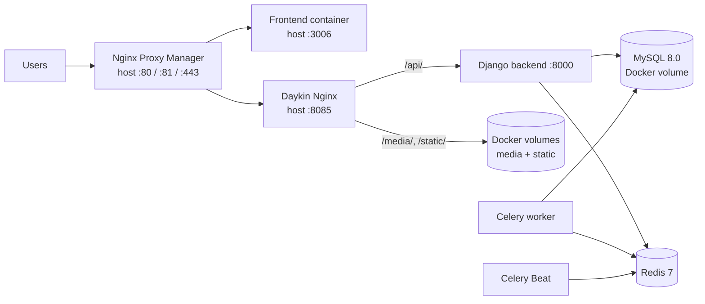

## After: Kubernetes (target design)

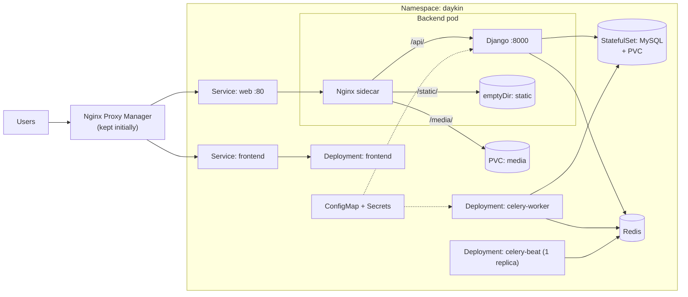

This is the **target design**. It is validated step by step, and the diagram is updated to match reality as the work progresses.

## Migration approach

| Phase | Goal | Status |
|---|---|---|
| 0. Discovery | Inventory the current deployment, record unknowns | ✅ Done ([plan](docs/Daykin_Docker_to_Kubernetes_Migration_Plan.pdf)) |
| 1. Backups and recovery | Verified MySQL and media backups, tested restore | ✅ Done |
| 2. Kubernetes foundation (isolated) | Local/test cluster, namespace, storage, config | ✅ Done |
| 3. App and data validation | Deploy all components, restore data copy, test | 🔄 In progress (final proof that the frontend reads cluster data left) |
| 4. Traffic cutover | Route via the proxy to Kubernetes, with rollback plan | ⬜ |
| 5. Cleanup | Remove old resources only after stability | ⬜ |

## Repository layout

```
.
├── README.md                 ← you are here
├── lessons-learned.md        ← real problems hit and how they were fixed
├── .env.example              ← variable NAMES only, never real values
├── k8s/                      ← manifests (placeholders, no secrets)
└── docs/
    ├── Daykin_Docker_to_Kubernetes_Migration_Plan.pdf
    ├── runbook.md            ← backup, restore, deploy, rollback steps
    ├── decisions/            ← short decision records (why X, not Y)
    ├── evidence/             ← screenshots
    └── posts/                ← plan for the milestone write-ups
```

## Key decisions (summary)

- [Why MySQL is a StatefulSet with a PVC](docs/decisions/0001-mysql-statefulset.md)
- [Why Nginx Proxy Manager stays in front at first](docs/decisions/0002-keep-nginx-proxy-manager.md)
- [Why I test outside production](docs/decisions/0003-test-outside-production.md)
- [Why Nginx runs as a sidecar in the backend pod](docs/decisions/0004-nginx-sidecar.md)

## Security

No secrets are committed to this repository. Manifests use placeholders, real values live in Kubernetes Secrets created out-of-band, and `.env` files are git-ignored. See `.env.example` for variable names only.

## Evidence

### Phase 0: Starting point


### Phase 1: Backups

Backup created on the server with no downtime (MySQL dump and media archive):


Copy kept on a second machine:


Restore test: the backup was loaded into a throwaway MySQL on my computer and row counts were compared with the live database.

Test copy (restored from backup):


Live database:


Result: all 22 tables restored and row counts matched the live database.

### Phase 2: Kubernetes foundation (local test cluster)

A local `kind` cluster (Kubernetes v1.37) running on my computer, separate from the live server. All control plane pods and the storage provisioner are Running:

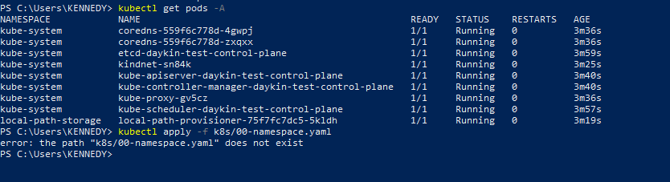

Redis deployed in the `daykin` namespace as a Deployment with a ClusterIP Service. The pod is `1/1 Running` and passes its readiness probe:

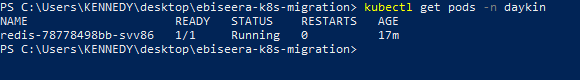

### Phase 3: App and data validation (in progress)

**Data restored into Kubernetes.** The production backup was restored into MySQL running as a StatefulSet in the local cluster. Row counts match the live database for all 22 tables, except `api_presence` (175 vs 178), a visit counter that kept growing on the live site after the backup was taken.

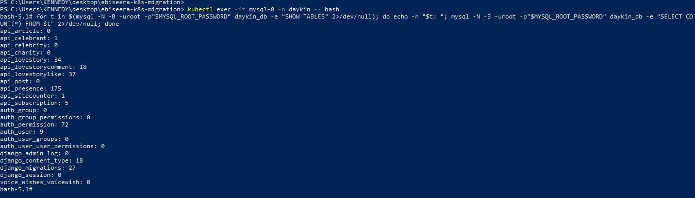

**Backend running in Kubernetes.** The Django backend (gunicorn) runs in the `daykin` namespace against the restored MySQL. It waits for the database, finds no pending migrations, and stays `Running` with 0 restarts.

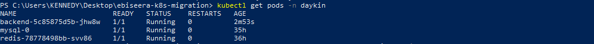

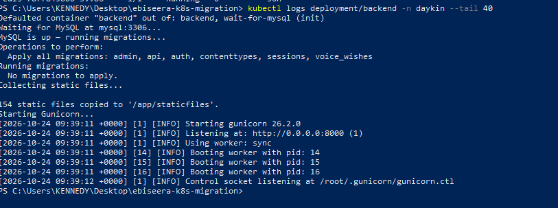

Note: the cluster currently runs a locally built test image (`daykin-backend:k8s-test`) that reads the DB host from configuration. The manifest still points at the production tag until the fix is released through CI.

**API answering from the cluster.** A temporary `kubectl port-forward` tunnel connects my browser to the backend pod. The love-stories endpoint returns `"count":34`, the same number of stories as the live site, so the whole chain works: browser → Django → MySQL in Kubernetes → restored data.

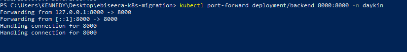

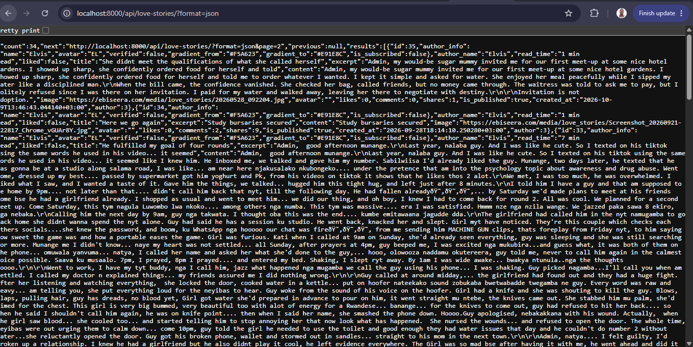

**Content verified, not just counts.** Row counts matched after the first restore, but reading real records through the API showed garbled emoji and quotes (a character-encoding problem caused by my restore command, not by the live data). I reloaded the data with `--default-character-set=utf8mb4` and verified again: text now matches the live site. Details in [lessons-learned.md](lessons-learned.md).

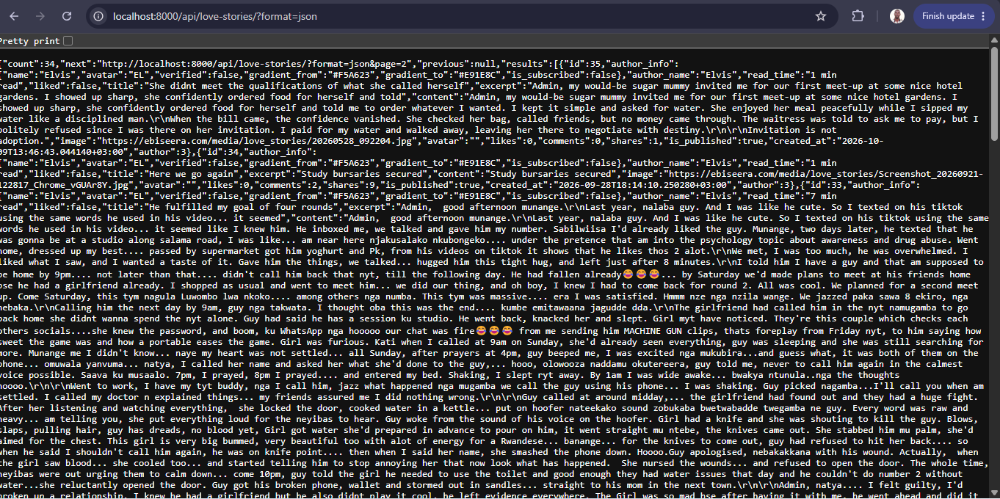

**Nginx sidecar.** The backend pod now has two containers: Django and Nginx. Nginx serves `/static/` and `/media/` and forwards `/api/` to Django, as the production Nginx does ([decision 0004](docs/decisions/0004-nginx-sidecar.md)).

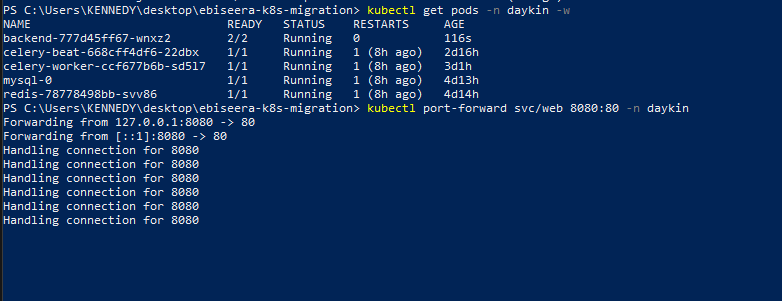

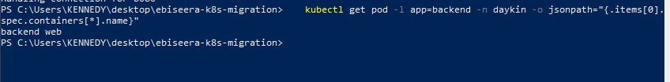

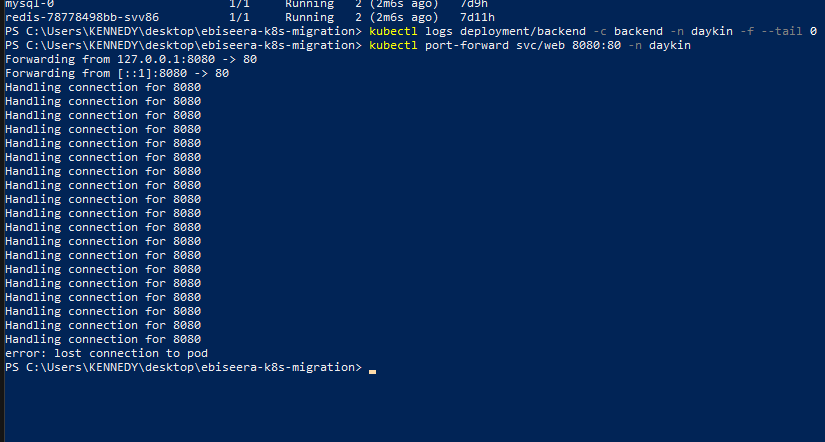

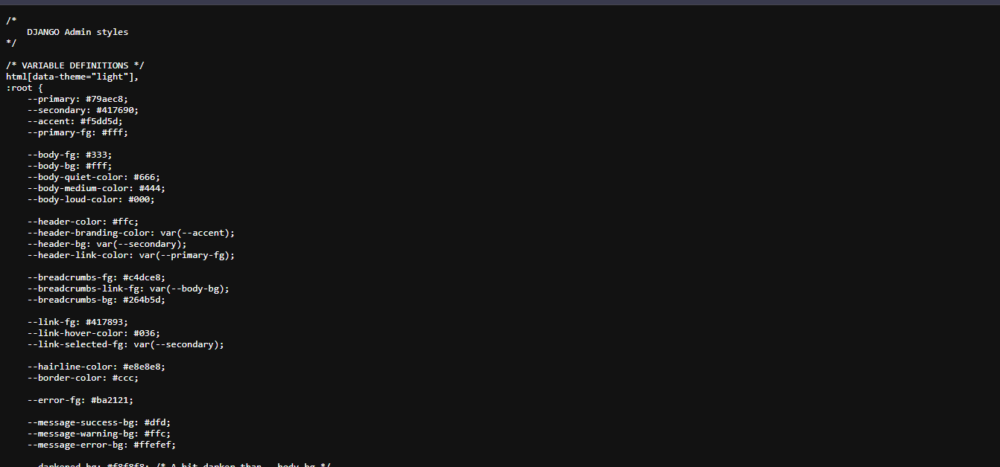

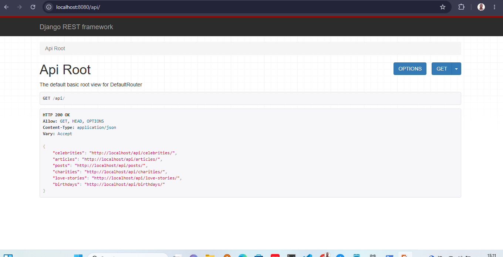

**Celery Beat and worker.** Beat sends the hourly `process_birthday_celebrations` task and the worker runs it successfully, shown here at 14:00 and 15:00. Beat runs as a single replica so the job is never triggered twice.

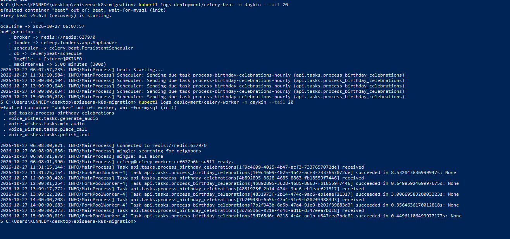

**Media restored.** The uploaded-media archive (143 entries, about 158 MB compressed) was restored into the cluster's media volume, and the count in the cluster matched the archive. Nginx serves a restored file with `200 OK` and the correct content type. I checked with headers only, so no personal photos appear here.

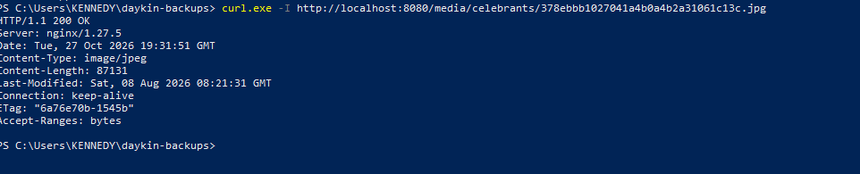

**Frontend deployed.** The React frontend runs as its own Deployment and Service, pinned to the exact image digest that runs in production. All six components (MySQL, Redis, backend with Nginx sidecar, Celery worker, Celery Beat, frontend) are now `Running` in the `daykin` namespace.

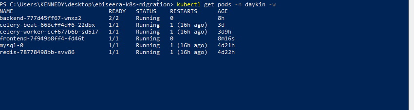

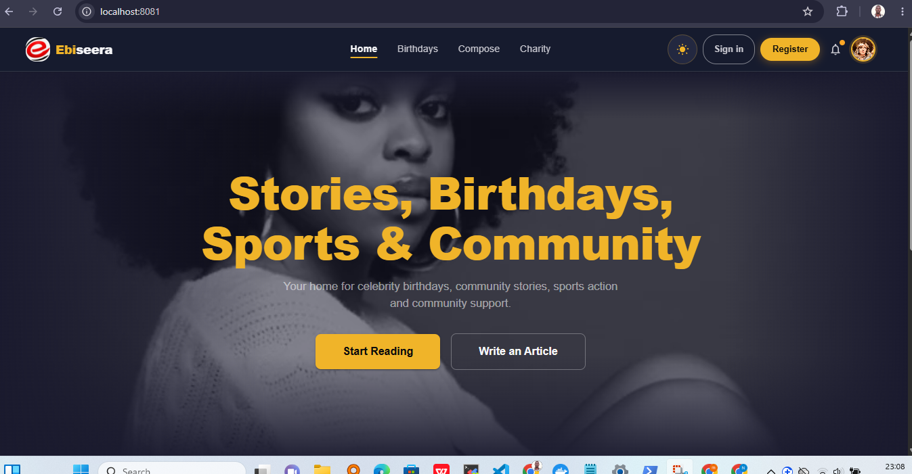

**The production build points at production.** This frontend build has the production API URL baked in. Opening it from `localhost:8081` shows the browser blocking its calls to the live API (CORS). That confirms the bundle uses the production URL, and that production correctly refuses unknown origins, so my test could not touch live data.

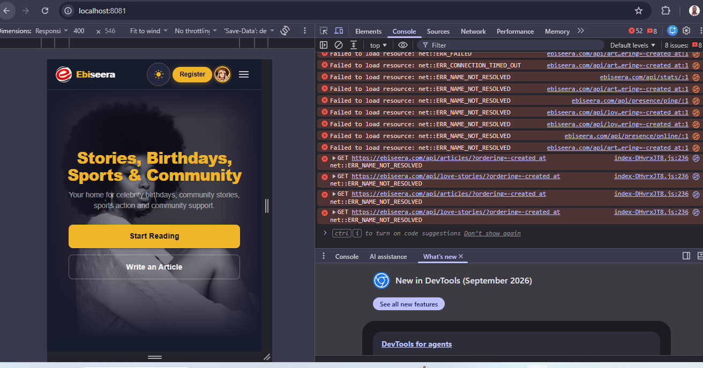

**Full browser test against the cluster.** The frontend source reads `VITE_API_BASE_URL` at build time. I ran the frontend on my PC with `npm run dev` and set that variable to `http://localhost:8080/api` for one PowerShell session only, so no source file changed and nothing could be pushed to the CI/CD pipeline. The browser's Network tab shows every request going to `localhost`, not `ebiseera.com`, and the app shows the restored data from the cluster's MySQL.

## Write-ups

Milestone posts will be linked here as they are published.

## About

Built by Kennedy Mutebi, computer scientist. Questions or feedback are welcome via issues.