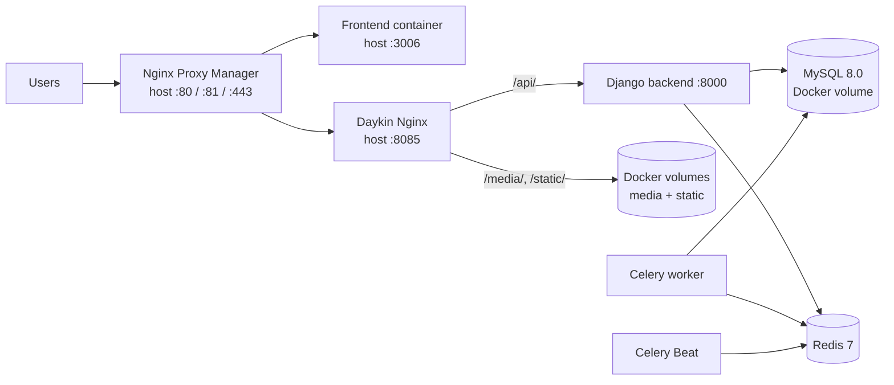
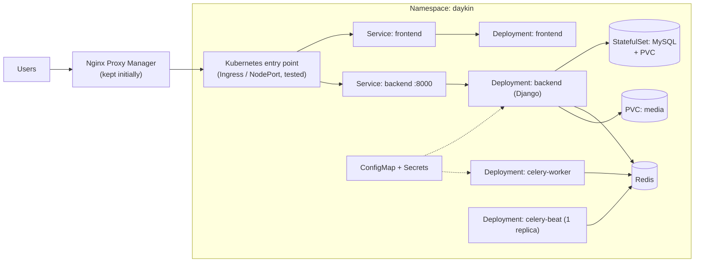
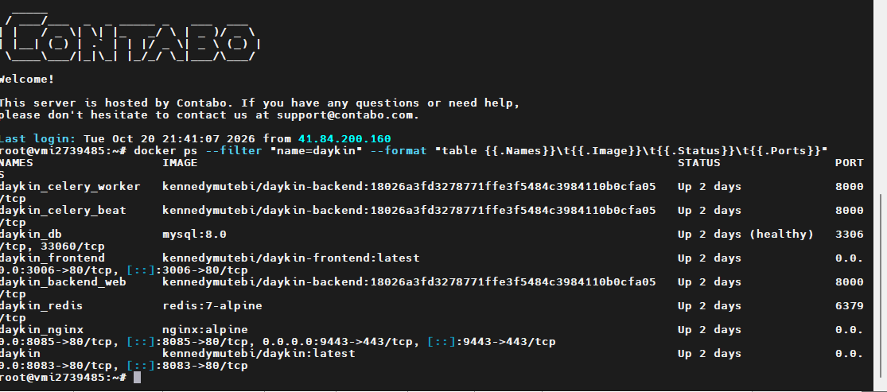
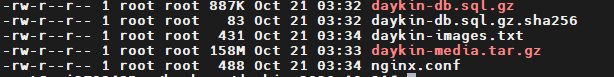
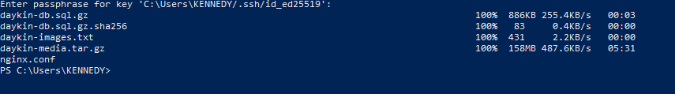
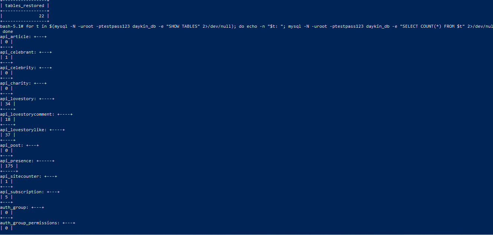
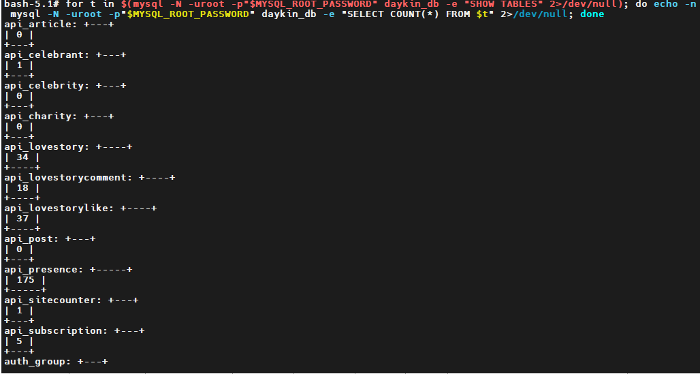

Ebiseera: Docker Compose → Kubernetes migration

A hands-on, documented migration of a real production application (Django API + Celery + MySQL + Redis + React frontend) from Docker Compose on a single VPS to Kubernetes, done with a backup-first, test-in-isolation, planned-cutover approach.

> **Status:** 🚧 In progress. Started 20 October 2026. This README is updated at each milestone.

## Why I'm doing this

I had learned Kubernetes theoretically and wanted to prove it on something real, not a to-do-app tutorial. Daykin or now called ebiseera is a live application with state (MySQL, uploaded media), background jobs (Celery worker and Beat), and a public reverse proxy, which makes it a good test of whether I can migrate carefully without breaking production.

Goals:

- Learn Kubernetes by operating it, not just reading about it.
- Practise safe change management: inventory → backup → isolated test → validation → planned cutover → cleanup only after stability.
- Document the real problems and decisions so others can learn from them.

## Before: Docker Compose on one VPS




## After: Kubernetes (target design)



This is the **target design**. It is validated step by step, and the diagram is updated to match reality as the work progresses.

## Migration approach

| Phase | Goal | Status |
|---|---|---|
| 0. Discovery | Inventory the current deployment, record unknowns | ✅ Done ([plan](docs/Daykin_Docker_to_Kubernetes_Migration_Plan.pdf)) |
| 1. Backups and recovery | Verified MySQL and media backups, tested restore | ⬜ |
| 2. Kubernetes foundation (isolated) | Local/test cluster, namespace, storage, config | ⬜ |
| 3. App and data validation | Deploy all components, restore data copy, test | ⬜ |
| 4. Traffic cutover | Route via the proxy to Kubernetes, with rollback plan | ⬜ |
| 5. Cleanup | Remove old resources only after stability | ⬜ |

## Repository layout

```
.
├── README.md                 ← you are here
├── lessons-learned.md        ← real problems hit and how they were fixed
├── .env.example              ← variable NAMES only, never real values
├── k8s/                      ← starter manifests (placeholders, no secrets)
└── docs/
    ├── Daykin_Docker_to_Kubernetes_Migration_Plan.pdf
    ├── runbook.md            ← backup, restore, deploy, rollback steps
    ├── decisions/            ← short decision records (why X, not Y)
    ├── evidence/             ← screenshots / recordings checklist
    └── posts/                ← plan for the milestone write-ups
```

## Key decisions (summary)

- [Why MySQL is a StatefulSet with a PVC](docs/decisions/0001-mysql-statefulset.md)
- [Why Nginx Proxy Manager stays in front at first](docs/decisions/0002-keep-nginx-proxy-manager.md)
- [Why I test outside production](docs/decisions/0003-test-outside-production.md)

## Security

No secrets are committed to this repository. Manifests use placeholders, real values live in Kubernetes Secrets created out-of-band, and `.env` files are git-ignored. See `.env.example` for variable names only.


## Evidence

### Phase 0: Starting point


### Phase 1: Backups
Backup created on the server with no downtime (MySQL dump and media archive):



Copy kept on a second machine:


Restore test: the backup was loaded into a throwaway MySQL on my computer and row counts were compared with the live database.

Test copy (restored from backup):



Live database:



Result: all 22 tables restored and row counts matched the live database.

## Write-ups

Milestone posts will be linked here as they are published.

## About

Built by Kennedy Mutebi, computer scientist. Questions or feedback are welcome via issues.
